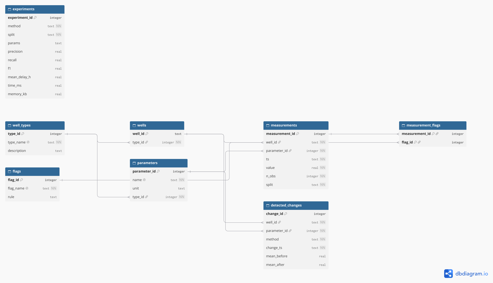

# Анализ режимов работы нефтяных скважин (Operating Regime Analysis of Oil Wells)

Итоговый проект по дисциплине **Programming for Data Analysis and Databases**, тема 27 (кластер 5: Industrial Sensor Data Analytics).
Автор: **Дана Султанмуратова, ADA-2603M** (индивидуальный проект). Преподаватель: Арайлым Тлеубаева.

## Цель

Сравнить фонтанные скважины и скважины со штанговым насосом и автоматически находить смены режима работы по почасовым данным датчиков.

Аналитические вопросы:
1. Насколько качественны данные (пропуски, флаги, известные проблемы датасета)?
2. Чем отличаются фонтанные и насосные скважины (остановки, суточные паттерны, корреляции)?
3. Какой метод лучше находит смену режима: baseline (порог), скользящие окна или бинарная сегментация?
4. Находят ли методы реальные события из описания датасета?

## Данные

[NK Oil Well Sensor Monitoring v2](https://huggingface.co/datasets/Arailym-tleubayeva/NK-Oil-Well-Sensor-Monitoring-v2) (HuggingFace, Apache 2.0), данные ТОО «Галаз и Компания».
258 387 строк (long), 10 скважин (3 фонтанные, 7 насосных), 01.01-30.09.2026, хронологическое разбиение train/test (до и после 08.08.2026).
Файлы данных в репозиторий не кладутся: программа скачивает их сама в `data/raw/`. Для темы 27 действует исключение по объему (меньше 500 тыс. строк).

## Как запустить

Нужен Python 3.11 или новее (проверено на 3.14.5).

```bash
git clone https://github.com/dsultless/oil_well_regimes.git
cd oil_well_regimes
python -m venv .venv
source .venv/bin/activate          # Windows: .venv\Scripts\activate
pip install -r requirements.txt

python main.py --all               # все шаги подряд, около 20 секунд
python main.py                     # интерактивное меню
streamlit run app.py               # дашборд в браузере (после main.py --all)
```

В Google Colab: загрузить папку проекта, выполнить `!pip install -r requirements.txt` и `!python main.py --all`.

### Меню (main.py)

| Пункт | Что делает |
|---|---|
| 1 | Скачать данные, прочитать CSV по частям, оптимизировать типы, сохранить Parquet, сравнить CSV и Parquet |
| 2 | Аудит качества: полнота, флаги, нули, разрывы, известные проблемы |
| 3 | Создать базу SQLite (3НФ), сравнить SQL и Pandas |
| 4 | Выполнить 12 SQL-запросов |
| 5 | Разведочный анализ и графики |
| 6 | Подобрать параметры методов на train, проверить на test и на реальных событиях |
| 7 | Найти режимы во всех скважинах, сравнить типы скважин |
| 8 | Анализ одной скважины: ввод скважины, параметра и метода вручную |
| 9 | Все шаги подряд |
| 0 | Выход |

## Структура

```
oil_well_regimes/
├── main.py              консольное меню
├── app.py               дашборд Streamlit
├── requirements.txt
├── src/
│   ├── config.py        пути, ссылки, константы
│   ├── data_loader.py   скачивание, чанки, оптимизация типов, Parquet
│   ├── quality.py       аудит качества данных
│   ├── transform.py     очистка, нормировка, long -> wide, состояния, ряды
│   ├── database.py      схема SQLite, загрузка, 12 запросов, SQL vs Pandas
│   ├── eda.py           статистика, суточные профили, корреляции, сравнение типов
│   ├── detectors.py     три метода поиска смены режима
│   ├── evaluation.py    полусинтетическая проверка, подбор на train, test, реальные события
│   ├── plots.py         графики и интерактивный HTML
│   └── pipeline.py      шаги проекта по порядку
├── database/            wells.dbml (схема DBML), er_diagram.pdf/png (ER-диаграмма из dbdiagram.io);
│                        сама база wells.db создается программой
├── data/raw/README.md   описание датасета от автора
├── results/
│   ├── figures/         графики PNG, скриншот дашборда, interactive_regimes.html
│   └── tables/          все результаты в CSV и JSON
└── reports/             отчет (docx, pdf) и презентация (pptx, pdf)
```

## База данных



ER-диаграмма построена в [dbdiagram.io](https://dbdiagram.io) по схеме `database/wells.dbml` (PDF: `database/er_diagram.pdf`).

Таблицы: `well_types`, `wells`, `parameters`, `measurements`, `flags`, `measurement_flags` (многие-ко-многим), а также таблицы результатов `detected_changes` и `experiments`.
Запросы используют JOIN, GROUP BY/HAVING, подзапросы, CTE, оконные функции LAG, RANK, ROW_NUMBER и скользящее AVG.

## Методы

Ряд для анализа: параметр одной скважины в часы работы, медиана за 6 часов. Остановки (SPM < 0.5 или давления < 0.5 атм) анализируются отдельно.

| Метод | Идея |
|---|---|
| Baseline: порог от эталона | эталон первых 7 суток; 4 точки подряд дальше k разбросов, значит новый режим |
| Скользящие окна | разница средних соседних окон, деленная на уровень шума; пики выше порога |
| Бинарная сегментация | рекурсивный разрез ряда там, где сильнее всего падает сумма квадратов; штраф за каждый разрез |

Оценка без утечки: полусинтетические ряды (настоящий шум + известные смены уровня + короткие выбросы), параметры подбираются на train, проверяются на test; плюс 9 реальных событий из описания датасета.

## Основные результаты

| Метод | F1 train | F1 test | Задержка test, ч | Реальные события |
|---|---|---|---|---|
| Baseline | 0.445 | 0.847 | 6.1 | 9 из 9 |
| Скользящие окна | 0.499 | 0.848 | 3.7 | 9 из 9 |
| Бинарная сегментация | 0.545 | 0.723 | 3.0 | 9 из 9 |

- Оптимизация типов: память 24.6 МБ до и 5.4 МБ после (-78%); Parquet 1.8 МБ против CSV 18.9 МБ.
- SQL и Pandas дают одинаковый результат (384 группы), SQL быстрее.
- Подтверждены известные проблемы: сдвиг масштаба dynamometer_area в мае (в 14-22 раза) и смена режима NK-7 в июне.
- Фонтанные скважины дольше стоят (6.8% часов против 3.2%) и сильнее зависят от времени суток.
- Основной метод (выбран по train): бинарная сегментация.

Подробно: `reports/Final_Project_Report_Sultanmuratova.pdf`.

## Ограничения

Нет разметки смен режима от оператора (оценка полусинтетическая), всего 10 скважин, причина сдвига dynamometer_area не подтверждена.

## Лицензия данных

Датасет: Apache License 2.0, Tleubayeva A. (2026), данные предоставлены ТОО «Галаз и Компания».
